# Niriko

**追番 · 收藏 · 统计** —— 一个以 Bangumi 为主数据源的 Android 原生应用。

> 仓库：<https://github.com/perchA5uka/Niriko> · 许可：MIT · 问题反馈：<https://github.com/perchA5uka/Niriko/issues>

管理动画 / 书籍 / 游戏 / 音乐 / 三次元的收藏与进度，查看放送日历与统计可视化，发现当下热门作品，并把 Steam、Bilibili、Kazumi 等平台的收藏导入进来。支持主题包、壁纸、玻璃质感界面与 WebDAV / Bangumi 双向同步。

| 项目信息 | 值 |
| --- | --- |
| 应用名 / 包名 | Niriko · `com.otakup.niriko` |
| 版本 | 1.2.2（versionCode 5） |
| SDK | minSdk 26 · targetSdk 34 · compileSdk 37 |
| 技术栈 | Kotlin + Jetpack Compose + Material 3 · 单 Activity |
| 本地存储 | Room（23 张表，v32） + DataStore Preferences |
| 单元测试 | 1551 项 JVM 单测（无需设备，当前回归全部通过） |
| 开源许可 | MIT（见 `LICENSE`；第三方组件见 `THIRD-PARTY-NOTICES.md`） |

---

## v1.2.2 更新（2026-10）

> 这一版没有新表、没有迁移：Room 仍是 23 张表 / v32，也没有新增 DataStore 键。主题是「动效与一致性收口」——把 v1.2.1 留下的玻璃观感从「静态好看」推到「按下去有回应、切过去有交代」。

### 控件语言统一（外观四项，A 方案）

- **分段**：唯一实现 `NirikoSegmentedControl`（Pill 容器 + 主色 20% 淡底 + 1dp 描边 + 等宽 + 13sp + 48dp 行高），接线 3 处：统计页日历模式、详情页观看状态、作品库状态计数行（新增 details 第二行计数）；沿用多年却零调用的空壳 `GlassSegmentedContainer` 已删除
- **chip**：四档语义 `NirikoTagPill`（信息）/ `NirikoFilterPill`（可切换）/ `NirikoSelectionPill`（选集，可长按）/ `NirikoActionPill`（动作）；旧 `TagChip` 删除，`ui/` 下 M3 `FilterChip` / `AssistChip` 归零
- **菜单**：`NirikoMenu` + `GlassMenuOverlay` 为唯一入口（24dp 玻璃、从锚点缩放展开、退场、Back/Esc、焦点进出与归还）；旧 `GlassAnchoredMenu` 删除、全站 M3 `DropdownMenu` 归零，详情页 5 处双行 `DropdownMenuItem` 刻意保留
- **统计数字**：`StatNumber`（24sp/w600/tnum，主指标用主色）+ `StatLabel`(13sp) + `StatNote`(11.5sp) + `StatTile`（图标+标签+数字）四处同源；统计页 20/22/26/28/32 五档字号清零，详情评分区/环心/年度统计共用同一档

### 修正

- **设置页横向缩进**：主页标题、分组标题、组卡此前是三种左缘（0 / 16 / 20dp），统一为 16dp；「外观」页里夹着的两档 20dp 分组改回 24dp；设置搜索框由 M3 描边输入框改胶囊玻璃外观，与站内其他搜索入口同一形态
- **设置行**：行高统一 56 / 72dp、箭头统一 20dp、右侧「当前值」只保留文字（删掉 8dp 小徽标）；禁用项整行降到 38% 不透明（此前与可用项看起来一样）
- **宽屏设置**：左列分类图标由实心绿圆改半透明圆角底；当前选中项有底色与箭头，不再「糊成一片」
- **详情页「详细信息」**：标题被 420dp 滚动容器裁掉一半——标题移出滚动区，长 infobox 只滚内容
- **详情页剧集结论条**：窄屏两行文字串在一起——改为自动换行 + 单行省略
- **详情页「评分分布」**：柱图从「直接压壁纸」包进玻璃卡，并与紧邻的评分卡左缘对齐
- **评分刷新失败**：此前失败会把已显示的权威评分清空——现在保留上次结果并给一条提示
- **分享图**：生成失败会永久停在「生成中…」——现在失败给出提示、留在面板里可重试
- **加载失败态**：补标题、图标与空态同尺寸、重试按钮改胶囊（此前是全站唯一的 M3 实心按钮）
- **骨架**：骨架卡圆角 12 → 20dp，加载完成不再看到圆角「跳」一下
- **输入框**：全站 37 处输入框调用点（`NirikoTextField` 在 15 个页面文件里共 37 次，另 1 处是组件自身定义；感想、标签、绑定的 Token/URL、搜索条件等）此前是 M3 默认描边样式（4dp 直角 + 1dp 描边，与站内胶囊/圆角语言冲突）——现在统一走 `NirikoTextField`（12dp 圆角、半透明填充、聚焦细描边），设置页与详情页不再各长一副面孔
- **选集 chip**：详情页「选集」13 格此前是 8dp 小矩形 + 描边，与全站胶囊语言不符——改为胶囊 + 半透明底，选中用主色淡底 + 描边
- **评分数字弹跳**：此前进详情页还没打分就先弹一下（`LaunchedEffect` 首帧也触发）——现在只在真的改分时弹，且「减少动态效果」下静默
- **圆角令牌**：83 处与令牌取值完全相等的字面量（999 / 24 / 20 / 16 / 12 / 4dp 与 `percent = 50`）改为引用 `NirikoShapes` 的六档令牌，**零像素变化**；剩余 60 处没有对应档位的小圆角保持原样并加了静态护栏测试（第八批再收敛 28dp/8dp 各 1 处，现为 58 处），防止以后又长回字面量
- **强调色令牌**：11 个在多个文件里各写一份的语义色（评分金、集数蓝、收藏红、状态四色、日历四色）收进 `ui/theme/AccentColors.kt`，**取值不变**；原来「日历角标」与「当日列表」的放送金各写一份，改单边就会分叉，现在只有一个出处
- **图表小件**：评分分布的柱条从直角改 4dp 圆角（矮柱自动收敛，不会变水滴）；图表标签原来写死 24 像素，改 `8.sp`——3 倍屏完全一致，其它屏幕密度与系统字体放大时才不再错位
- **收藏概览**：顶部统计胶囊的弱形态从半透明（α0.7，会与壁纸混色、对比度随机）改实底，文字统一过 `ensureReadable`；强调与否改由字重与文字色区分
- **控件迁移（V-13）**：设置页数值滑块 → `GlassSlider`；搜索筛选面板的 M3 `Switch` → `GlassToggle`、`RangeSlider` → 新 `GlassRangeSlider`（双 thumb 结算走纯函数 `GlassRangeSliderMath`）；B 站同步开关、剧集评分（`GlassRatingSlider`）一并迁移；`ui/` 下 M3 `Switch` / `Slider` / `RangeSlider` 用量归零，由 `ControlSourceTest` 锁死
- **分区标题（V-15）**：`SectionHeader` 真实调用从 4 处扩到 **43 处**（详情 19 / 人物 5 / 角色 3 / 剧集 4 + 来源·关联·剧集·人物等分区 12），剩余 6 处 `titleMedium + Bold` 是「数值强调」而非标题，按文件锁死计数
- **drill-in 页标题（V-16）**：6 个二级页（作品/人物/角色/制作人员/剧集/Steam 登录）标题从 `titleLarge`(22sp) 统一到 `headlineSmall`(24sp/w600)，与设置二级页同档
- **色值归位（V-02）**：`CardRarityMaterial` 的 23 色等值搬进 `ui/theme/RarityPalette.kt`、搜索挡板 2 个绿进 `SearchIndicatorAccents`、`LibraryGalleryCard` 2 色清零；`ui/` 下 `Color(0x…)` 只剩 `theme/`、`share/` 与 `LiquidGlassTokens.kt` 三处合法域，由 `ThemeColorAuditTest` 守住
- **字号收口（V-03）**：统计/日历/详情的小字全部走 `labelSmall`(11.5sp) / `labelMedium`(13sp)；日历角标改实底 badge（用形状+底色辨识，不再靠 7–9sp 字号差）；`LibraryGalleryCard` 的 9/12/19sp 清零；`fontSize = N.sp` 只剩 `Type.kt`（定义）、`Badges.kt`（压图 10sp 刻意）、`share/**`（隔离域），由 `TypographyLiteralAuditTest` 守住

### 视觉与交互

- **二级设置页横向推入**：进出设置子页改为左右位移 + 淡入（复用 v1.2.1 就写好但零调用的 `enterFromRight/exitToRight`），返回方向相反；顶部四页与封面共享转场不变
- **设置行按压**：整行矩形高光（α0.08），按下快、松开慢；替换原先的 M3 圆水波
- **玻璃开关可以拖**：此前只能点、拖到一半松手会弹回去；现在跟手拖动、松手按速度或过半落位，按下 thumb 放大 8%
- **玻璃滑块**：按下 thumb 放大 10%，高光跟手
- **卡片受光角度**：倾斜压卡时高光角度随倾斜偏移（±20°），不倾斜时与改动前逐像素一致
- **折叠区块**：详情页折叠项从「瞬间加减」改成高度展开 + 淡入，箭头 180° 旋转
- **锚定菜单**：从触发控件位置缩放展开（此前从中心胀大或直接硬切），关闭有退场
- **非模态面板**：拖动松手带速度惯性、回弹更连续（此前每次 pointer move 起协程，跟手发飘）；把手首次拖动有触感
- **封面**：加载完成 150ms 淡入；共享元素飞行期间强制不淡入（否则拖影）
- **多选**：列表视图选中项有描边环（与网格一致）；多选时长按不再误弹状态浮层
- **全局提示**：收藏 / 发现 / 搜索 / 统计页此前没有 Snackbar 宿主，批量删除、改状态、导出日历都静默——现在窗口层有统一提示条，并给底部 dock 让出 96dp
- **「减少动态效果」覆盖**：搜索卡展开/收起（12 个过渡值）、筛选面板展开、发现页 tab 底色、顶栏滚动隐藏、底栏重选回顶，此前无视系统设置照常播动画——现在全部降级为瞬时；第二批又补上详情/绑定/同步等 9 处折叠面板的展开收起、详情页材质墙与 chrome 收起、状态分段色、列表与搜索结果的内容尺寸变化。跟手拖拽、按压、一次性触感**刻意保留**（关了动画也仍要「摸得到反馈」）
- **骨架 → 正文的揭示**：详情页、统计页此前骨架消失与正文出现是同一帧硬切——现在正文有一次 180ms 的淡入包络（详情 0.55、统计 0.55 起）；`false→true`（刷新）不压暗，只在首次进入时播
- **列表 ↔ 网格切换**：作品库换视图此前整块瞬移——现在内容先压到 60% 亮度再 180ms 回满（呼吸式）；刻意不用 `AnimatedContent`：那会让列表与网格两棵 Lazy 同时组合（双份图片请求），是性能红线
- **顶/底栏与详情 chrome**：底栏隐藏、顶栏滚动隐藏、详情页 chrome 收起、搜索页顶栏此前各自写 220 / 180ms 字面量——现在统一走 `CHROME_HIDE_DURATION_MS` / `DETAIL_CHROME_DURATION_MS`（**取值一个毫秒未改**），内容尺寸变化的 300ms 也改走既有 `AnimDurationNormal`；新增护栏测试防止以后又写裸数字
- **四态切换（B-13）**：新 `StateHost`（单实例、0.55→1 淡入包络、180ms、首帧不播、reduceMotion 瞬切）接线 7 屏（人物/角色/制作人员/趋势/发现/搜索结果/作品库首屏）；刻意不用 `AnimatedContent` —— 过渡期会同时组合两棵 Lazy，是性能红线
- **日历切月（B-15）**：标题改 `AnimatedContent`（只包标题、不引入双 Lazy，`sizeTransform = null`），翻月方向由纯函数判定；切周/月换粒度无方向，只淡入淡出；reduceMotion 下两侧 `None`
- **筛选面板（B-14）**：面板内补 `animateContentSize`（spatial 档、可降级），两个面板的 8 处手写 spring 收进 `panelEnter` / `panelExit`
- **搜索结果逐条入场（B-16）**：搜索结果/榜单列表项 `animateItem()` 逐条入场已核实在位，不再整块淡入
- **搜索卡收口（B-11，未结构重写）**：12 处手写时长/弹簧字面量 → 六档令牌，5 处 reduceMotion 降级；尺寸与位移的读取从组合期移到布局/绘制期（新 `AnimatedLayoutSize.kt` 的 `animatedRequiredSize`、`offset { }`）。**没有做结构重写**（不合并单一 progress、不做 graphicsLayer 尺寸近似）：需真机逐帧调，文件头已写取舍
- **帧阶段（A.9）**：底栏/宽屏 dock 的隐藏进度改成在 `offset { }` / `graphicsLayer { }` 的 lambda 内读取 + `derivedStateOf`（不再每帧重组整条 kyant 底栏）；时间线页偏移、页面指示器（改 Canvas 自绘）、进度条填充与 range thumb 位移均移到绘制/布局期
- **预测返回（B-9，真机未验）**：Navigation-Compose 2.8.5 的 NavHost 内部已用 `PredictiveBackHandler + SeekableTransitionState` 对 popEnter/popExit 跟手 seek（用 aar 字节码核实）；新增 `PredictiveBackSupportTest` 钉住版本、清单开关、四条过渡、reduceMotion 分支与 popExit 缩放 ≤12%。**真机边缘滑动逐帧未验证**
- **封面重播（P2-2）**：进程级 `CoverRevealTracker`（上限 512 FIFO）记录已揭示的封面 URL，列表滚回不再重播 150ms 淡入
- **刷新 pending（F-05）**：`StatsViewModel.isBroadcastRefreshing` 外露，日历刷新胶囊显示「刷新中…」并禁用，不再点了没反应
- **剧集行（S02/S03/S04）**：评分徽标移到 meta 下一行（不再把 meta 挤成「2…」）；行尾常驻 chevron（展开旋转、reduceMotion 瞬切）；「全部 N 张」48dp 命中盒
- **解绑二次确认（S07）**：TMDb / AniList / VNDB 解绑改确认对话框，文案与 VM 行为一致（TMDb 会删来源分集评分）；TMDb 解绑补 snackbar 回执
- **infobox「打开链接」（S08）**：从 8dp 小矩形改 `NirikoActionPill(OpenInNew)`（48dp 命中壳）
- **触感与按压补点（F-07/F-08/F-10/F-12/F-14/F-15）**：选集 pill 长按触感；搜索菜单 chip/type cell 按压高亮 + selected 语义；TrendTab 按压 + selected；搜索关闭钮 48dp 外壳（视觉 44 保持）；5 张主卡开启 `pressTilt` 触感；保存回执由 `LongPress` 改 `Confirm`
- **hero 单击翻面（F-11）**：详情页封面单击即翻面（保留双击）；单击有约 300ms 的双击等待，已记账；未引入 DataStore 首次提示

### 新功能

- **Kazumi 传送门（手机端 A1 批，2026-11-08）**：详情页可把当前作品交给 Kazumi 打开——已装 2.4.0+ 走 `kazumi://bangumi/<Bangumi 条目 ID>` 直达番剧详情，老版本回退到 `LaunchPackage`；拉起前把作品标题复制到剪贴板并提示「粘贴即可搜索」；未安装时按钮改为去下载
- **详情页底栏改造（手机端 A1 批）**：底栏改为「传送门」主胶囊 + 只读收藏状态胶囊；「编辑收藏」入口从底栏上移到顶栏（仅已收藏时出现），已收藏时底栏不再显示 `›`

### 行为变化（可能被误认为 bug）

- 设置二级页现在有左右滑动转场（此前是淡入缩放）；平板两栏布局下同样是推入
- 设置页所有分组左缘内缩 16dp，内容区略窄
- 详情页「详细信息」卡在长 infobox 时比原来高约 44dp（标题不再与内容抢 420dp 上限）
- 玻璃开关支持拖动后，从 thumb 上开始滑动会改变数值（此前纯点击）
- 「评分分布」卡在玻璃档位为 FULL 时仍是瓷面卡（不加实时折射）：刻意的性能取舍，不是漏改
- 提示条统一挂在窗口层底部、位于 dock 之上；无底栏的布局不会让出这 96dp
- 输入框视觉全站换了一副样子（12dp 圆角 + 填充底）：密排表单页（数据源、同步备份）会明显不同
- 选集 chip 从方角小块变成胶囊，同一行能放下的格数可能变化
- 进详情页/统计页时正文有一次约 180ms 的淡入（详情页这次淡入与封面共享飞行同期，飞行时长仍是 200ms）；作品库换视图时内容会先压暗一下再回满
- 详情页/统计页的骨架→正文、作品库的换视图都**没有**用 `AnimatedContent`：这是刻意的性能取舍（两棵 Lazy 同时组合会翻倍图片请求），不是漏做
- 时长令牌化只是「换引用」，所有动画时长与改动前完全相同：如果你觉得「变快了/变慢了」，那是心理效应
- 详情页底栏从「两枚等宽按钮」改成「传送门胶囊 + 状态胶囊」，编辑收藏改从顶栏铅笔进入；已收藏时底栏状态胶囊只读
- 传送门拉起 Kazumi 前会覆盖系统剪贴板（写入当前作品标题），这是刻意行为

### 本版未做

- **真机验证全部未做**：无设备连接。06-roadmap §7 的 320/360/411/600/840dp × 7 主题 × 3 玻璃档 × reduceMotion × fontScale 矩阵无记录；仓库也没有 roborazzi/paparazzi 之类的截图测试设施，`screenshot/` 仍是 2026-09-25 旧图
- **同屏 RenderEffect 实测未做**：`GlassRenderEffectBudgetTest` 只数源码构造点（13 个），数不到「同屏运行几个」；FULL 档下分段控件与菜单都走实时折射路径，同屏是否 ≤2 未知
- **B-11 结构重写**（单一 progress 驱动、尺寸走 graphicsLayer 近似）未做：需真机逐帧调，留待下一版；本轮只做字面量收口、reduceMotion 与帧阶段
- **V-04 材质分层**：用户 D1 裁决「不收」，`GlassDecision` 不动，只保留「不新增 RenderEffect 构造点」护栏
- 58 处无对应档位的圆角字面量（0/2/3/6/8/10/11/14/28/48/50dp，小件与 kyant 移植值）保留：`ShapeLiteralPolicyTest` 以**精确相等表**锁值锁次数
- 详情页 5 处双行 M3 `DropdownMenuItem`：双行副标题没有自定义槽位，`ControlLanguagePolicyTest` 按文件锁死数量
- `RatingComparisonSection` 的 Canvas 刻度仍是 `8.sp`：要改需同步改图表底部留白，本轮不动
- 已知取舍：hero 单击翻面有约 300ms 双击等待；剧集评分改为「停止拖动 600ms 落库」（原实现松手即存），可能丢最后一次拖动
- V-15 剩余 6 处数值强调（`titleMedium + Bold`）：是数据而非分区标题，刻意保留并锁死计数
- 单处使用的 `Color(0x…)` 不再追缴：`ui/` 下越界已清零，只剩 `theme/`、`share/`、`LiquidGlassTokens.kt` 三个合法域（11 个强调色令牌保留在 `AccentColors.kt`）

---

## v1.2.1 更新（2026-10）

> 这一版没有新表、没有迁移：Room 仍是 23 张表 / v32，只新增了 3 个 DataStore 键。

### 修正

- **同步并发收敛**：写请求带 `If-Match` 与客户端 UUID；两设备同时改不再「后写覆盖」，而是 412 三选一（保留本地 / 用远端 / 合并）；失败按网络 / 认证 / 冲突 / 服务端分类，退避与并发上限可配；新增同步基线，合并只处理真正变化的条目
- **统计口径与时区**：放送时刻按设备时区换算（`AirTime`），跨日/跨月不再错位；总集数只统计本篇，SP/OP/ED 单独计数；卷进度按书籍类型判定（单卷不显示卷条）
- **详情页收层**：收藏成功后等庆祝动画播完再收层，不再「庆祝中提前收层」；单卷书籍的卷进度条隐藏
- **Steam 登录**：改用桌面 UA、只认真正的回调 URL、HTTP 错误页给出可读原因、失败可重试；登录中禁用重复提交
- **滚动隐藏方向**：按真机手感校正（向下滑隐藏 / 向上滑恢复），阈值 48dp 隐藏、16dp 恢复，回弹与程序化跳转不误判
- **顶部渐隐**：三页统一从**屏幕顶部（含状态栏）**开始连续渐变，不再在悬浮控件位置留固定色带；内容顶部内距仍按控件高度避让
- **切页闪烁**：pager 顶部按钮改为按 `settledPage` 直接切换内容，去掉交叉淡入
- **详情页隐藏时效**：改用原始滚动位移上报，滑到第 N 项后仍能隐藏（原先只在顶部附近生效）

### 视觉与交互

- **内置 Kyant Shapes 1.2.1**（Apache-2.0，11 个源码文件）：连续曲率圆角 `Capsule` / `RoundedRectangle`；上游用 Kotlin 2.4 构建，与本项目工具链不兼容，故以内嵌源码方式引入，并在依赖上排除 backdrop 传递的同名 AAR
- **玻璃开关与进度条**：设置页 34 处 M3 Switch 换成玻璃胶囊开关；统计/收藏卡进度条换成同源玻璃条
- **表面圆角 token**：分组卡 24dp（`Sheet`）、组内行 4dp（`RowInner`），设置页与高频二级页统一
- **编辑层贴顶**：收藏编辑 bottom sheet 去掉把手与内边距、全宽零圆角，短内容也顶到窗口顶
- **收藏按钮合并**：未收藏按钮与已收藏 Dock 合并为 28dp 悬浮玻璃胶囊两态，始终浮在窗口层，列表从下方滚过
- **同窗口菜单浮层**：顶部选择器与筛选菜单不再用 Popup，先量后排、与触发控件同一窗口，消除采样错位
- **搜索遮挡与误触**：展开态垫 94% 实心底；收起动画期间菜单行不响应点击
- **骨架对齐**：首屏骨架与正式列表共用顶距公式，数据到达不跳版

### 新功能

**统计**

- **今晚看什么**：今天更新的在看作品 + 已看集数 + 放送时刻；空态不渲染
- **接下来七天**：7 列日期/首封封面/更新数，今天高亮
- **漏看提醒**：落后 ≥3 集才计数，点进去是筛好的列表
- **收藏健康度**：停滞 / 看过未评分 / 无标签 / 想看超一年 四类计数
- **一句话对比**：比上月多几部、连续几个月下降；数据不足自动降级
- **完成率口径说明**：点「?」看到三种分母对照，并解释为什么剔除「想看」

**日历**

- **`.ics` 导出**：UID 幂等、估算集用 `FREQ=WEEKLY;COUNT=N`、内联 `VTIMEZONE`、75 octet 折行；范围本月 / 本季 / 在追全部
- **停播 / 延期角标**：日历格与日详情标「停 / 延」，延期给出原定日期；集数据不完整时一律不判定

**发现**

- **榜单 ▲▼**：历史排名行尾显示名次变化（周快照，ISO 周键，同周重开不丢箭头）；首周无快照不显示

**详情**

- **标题 logo**：读取 TMDb `logos`，**中文优先、其次日文**（其他语言不用）；宽度为海报宽度的 2/3 并居中，单行高度有上限；对比度不足自动回退文字；加载中同尺寸占位。设置 → 外观 → 详情页标题 三档（默认「只用文字」）
- **外部源区块折叠**：Steam / 权威评分 / AniList / VNDB / TMDb 绑定区块可收起，按 `subjectId + sectionId` 记忆
- **评分对照卡**：详情页分享面板可直接生成与 Bangumi 评分的对照图

**分享**

- **分区海报**：当前分区 3×4 分页封面海报（每页 12 部，最多 4 页），多页一起分享
- **周报卡**：本周观看摘要渲染器（入口在统计页，后续接）

**设置**

- **设置搜索**：顶部搜索框，覆盖 8 个分类与同义词，命中高亮并跳分类
- **玻璃自动档**：按设备能力自动降档，与用户档位取交；行内显示「本机 X · 生效 Y」
- **深色对比度**：正文级 `onSurfaceVariant` 过一遍 WCAG 4.5:1（保持色相的最小改动）
- **数据体检**：8 项只读检查（计数/孤儿/空进度/源有效性…），给严重度与建议
- **本地快照**：同步上传、导入合并/覆盖前自动 gzip 落盘到 `files/snapshots`；保留最近 5 + 每日 7；失败不阻断主流程
- **图片占用清理**：剧照/封面/分享图/导出文件四类体积，支持清理 30 天未访问的剧照缓存
- **数据源自检**：任意源 × 能力矩阵 + 串行 2s 探测，失败给摘要
- **检查更新**：查 GitHub Releases 最新 tag，只提示并打开发布页，不下载、不安装

### 行为变化（可能被误认为 bug）

- 完成率默认分母剔除「想看」，数字会比 1.2.0 小
- 标题 logo 默认关闭；没有中日文 logo 的作品显示文字标题（不拿英文凑数）
- 榜单箭头首周不显示（需要上周快照）
- 对话框仍是**不透明表面色**：`AlertDialog` 有独立窗口，backdrop 跨不过去；真玻璃需要 API 34 `WindowBlurBehindEffect` + 自绘
- 本地快照、榜单周快照等新键暂未纳入 JSON 备份与 WebDAV（缺键走默认，不报错）

### 本版未做

- 英文界面（约 475 个文件的文案抽取，单独立项）
- 键盘可达与报错一键复制
- 周报卡入口（渲染器已完成）
- 体检的「一键修复」执行器（只读检查已就绪）
- 其余 21 个 `AlertDialog` 的圆角统一（已换 3 个高频）

---

## 目录

- [v1.2.2 更新](#v122-更新2026-10)
- [v1.2.1 更新](#v121-更新2026-10)
- [截图](#截图)
- [功能总览](#功能总览)
- [数据源与整合](#数据源与整合)
- [收藏模型](#收藏模型)
- [导入与同步](#导入与同步)
- [主题与个性化](#主题与个性化)
- [技术栈与架构](#技术栈与架构)
- [数据模型与迁移](#数据模型与迁移)
- [刷新与缓存](#刷新与缓存)
- [构建与运行](#构建与运行)
- [目录结构](#目录结构)
- [开发约定](#开发约定)
- [设计文档](#设计文档)
- [数据来源与声明](#数据来源与声明)
- [已知限制与后续计划](#已知限制与后续计划)

---

## 截图

> 以下截图取自 Android 设备实机运行，部分反映早期版本界面；v1.2.0 的顶部选择器、展开搜索与工具入口等以当前应用为准。完整分辨率原图不随仓库分发，README 使用的是 600px 宽的压缩版本。

### 作品库

| 列表视图 | 观看状态编辑 |
| --- | --- |
| 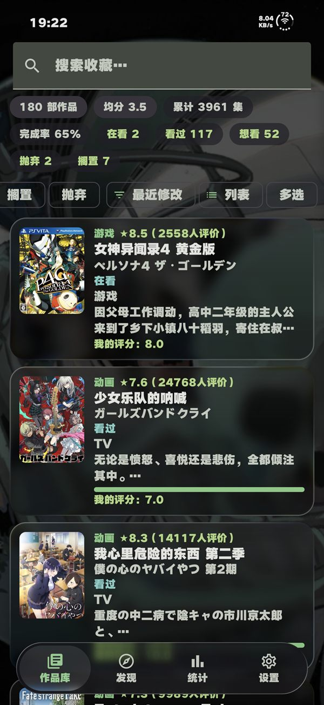 | 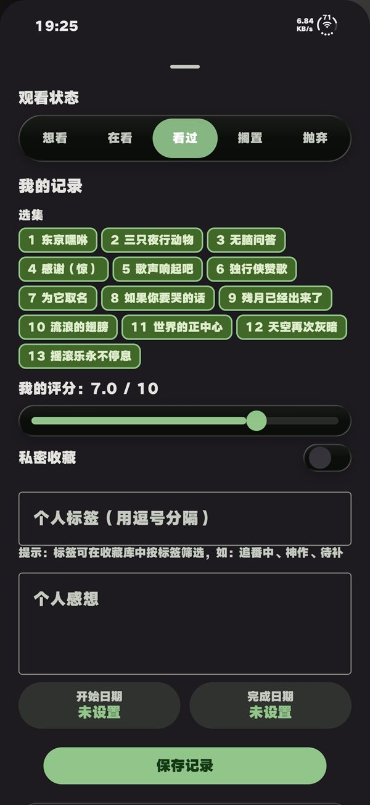 |

### 发现

| 当季热门 | 历史排名 | Steam 热销榜 |
| --- | --- | --- |
| 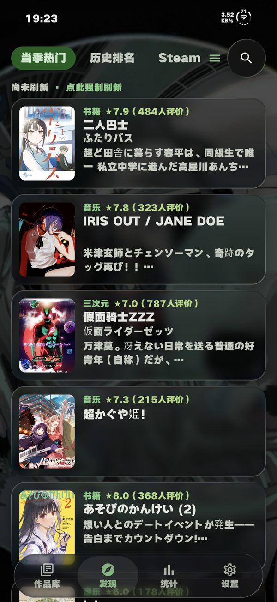 | 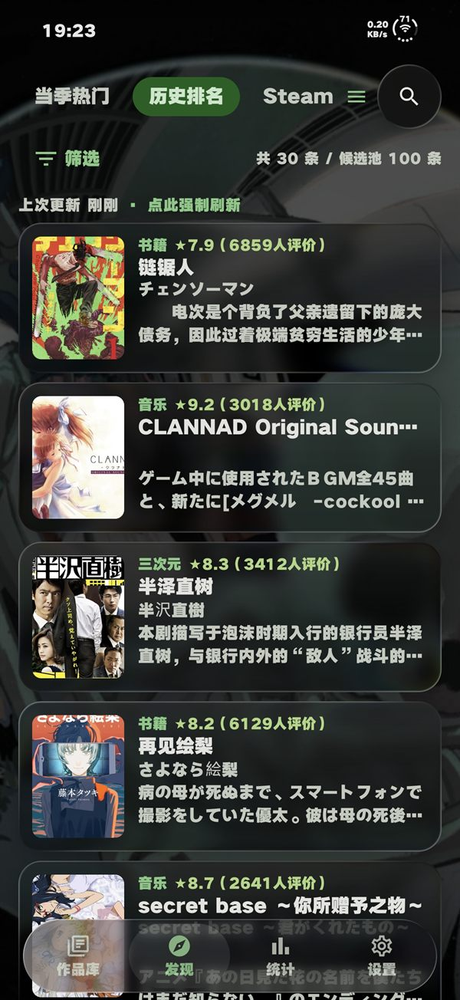 | 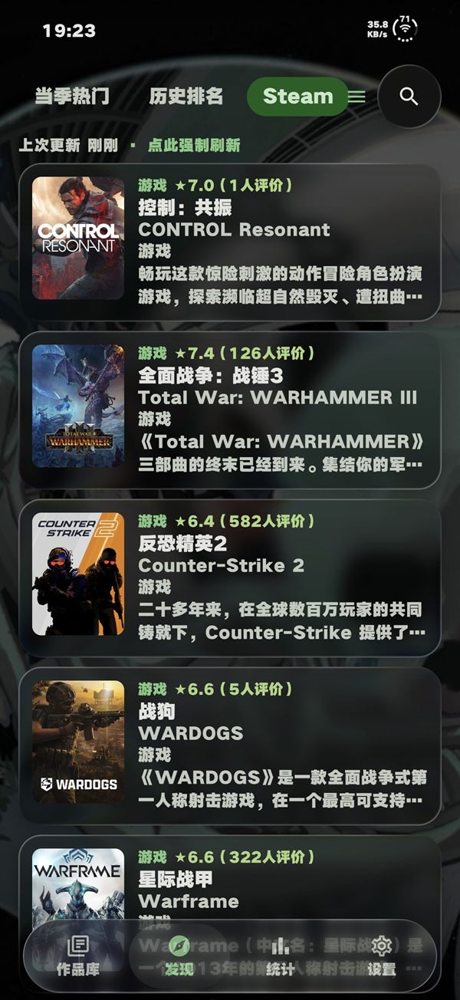 |

### 作品详情

| 封面与简介 | 简介原文与 infobox | 外部绑定 / 关联条目 / 取景地标 |
| --- | --- | --- |
| 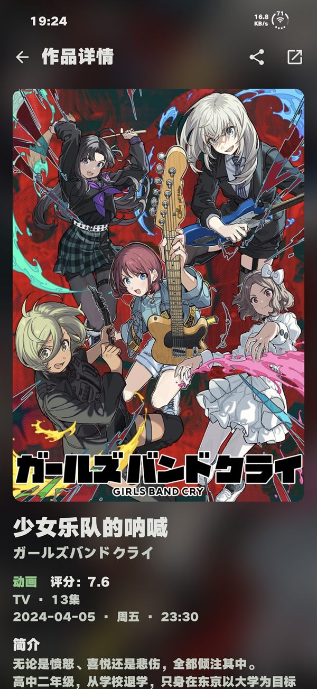 | 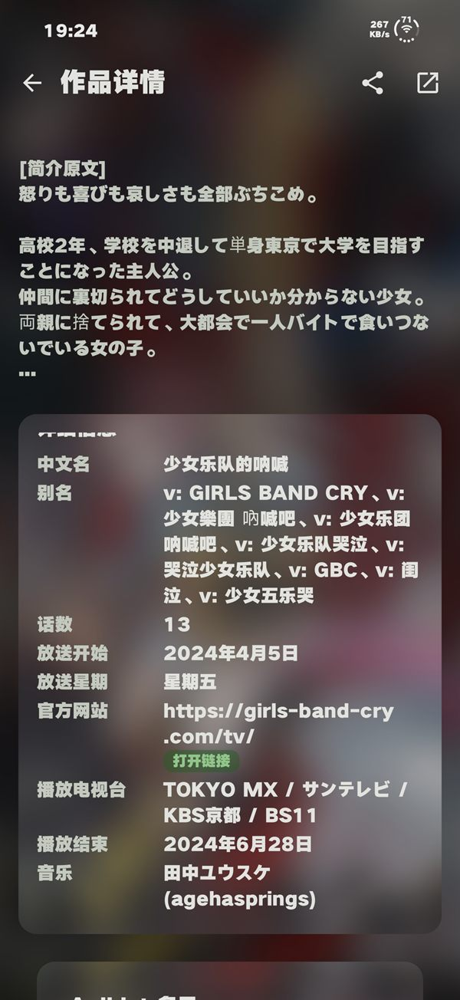 | 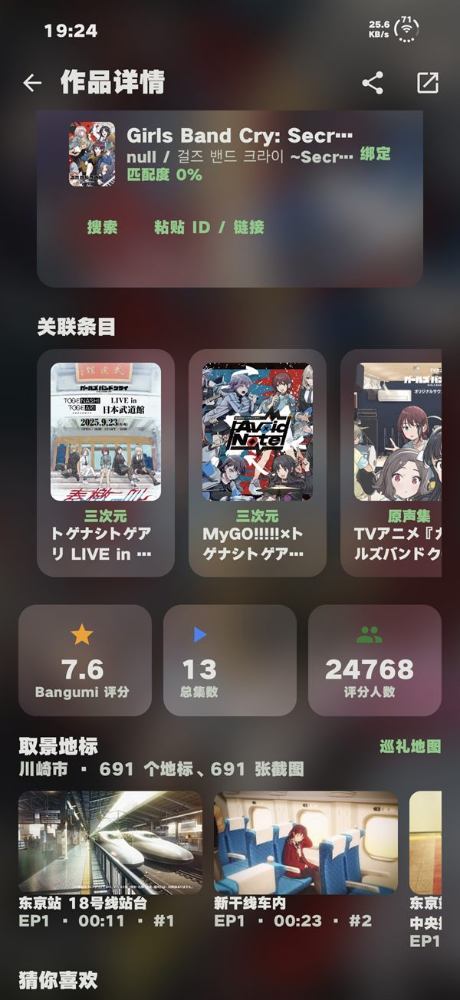 |

| 评分对比与评分分布 | 角色、制作人员与标签 | 剧照与剧集评分曲线 |
| --- | --- | --- |
| 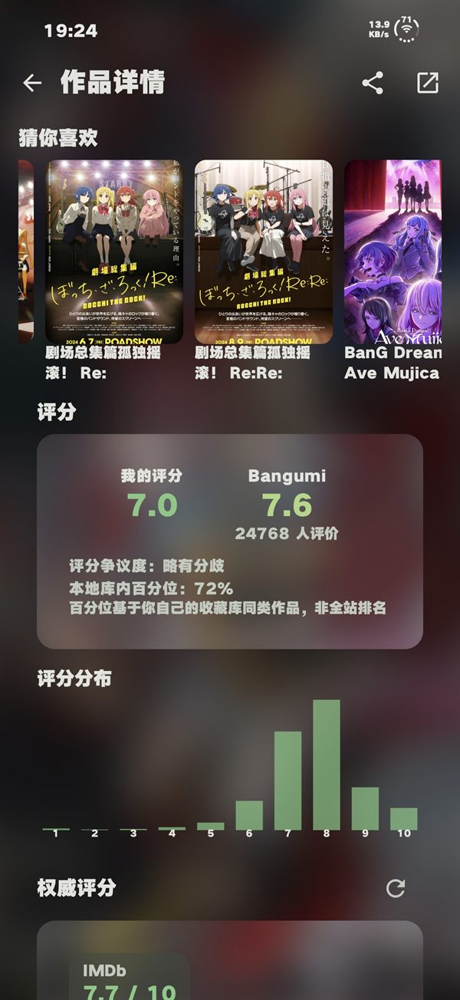 | 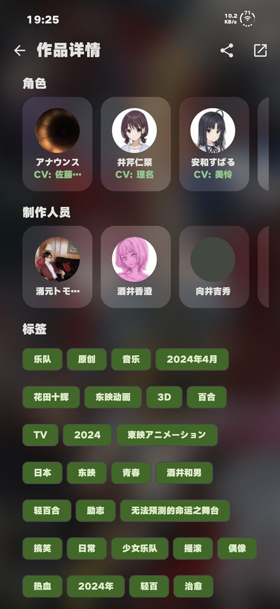 | 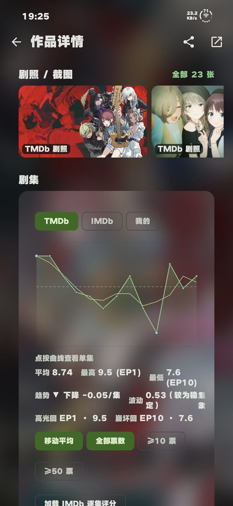 |

| 剧集列表与外部源绑定 |
| --- |
| 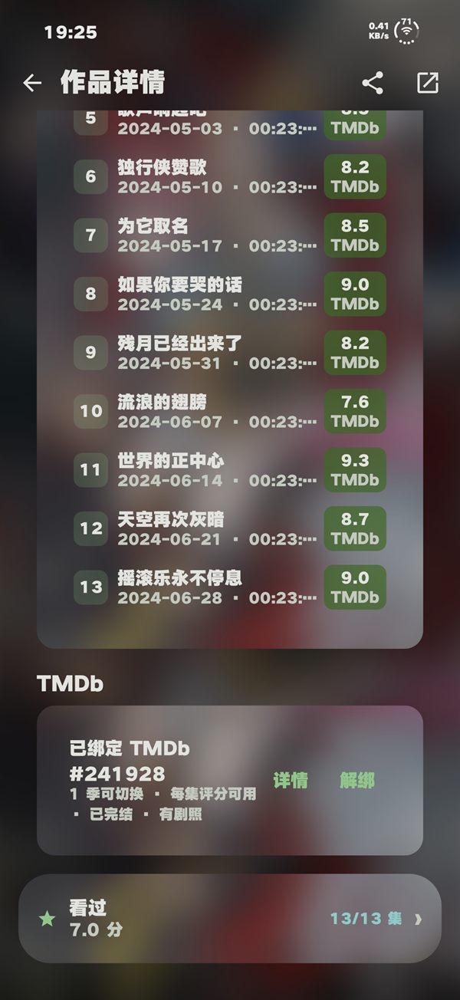 |

### 统计

| 作品日历与时间线 | 收藏概览与状态分布 |
| --- | --- |
| 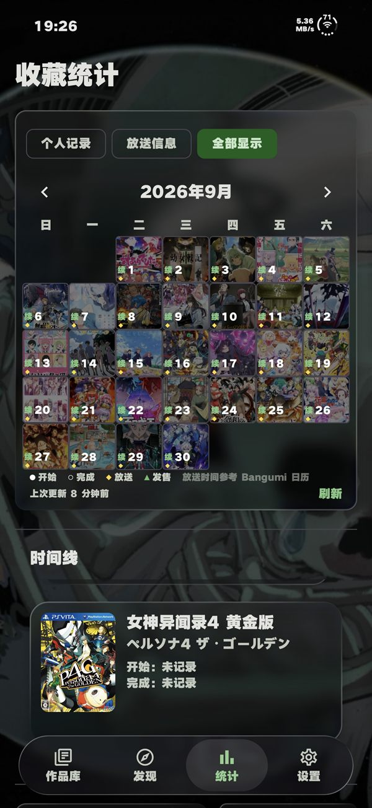 | 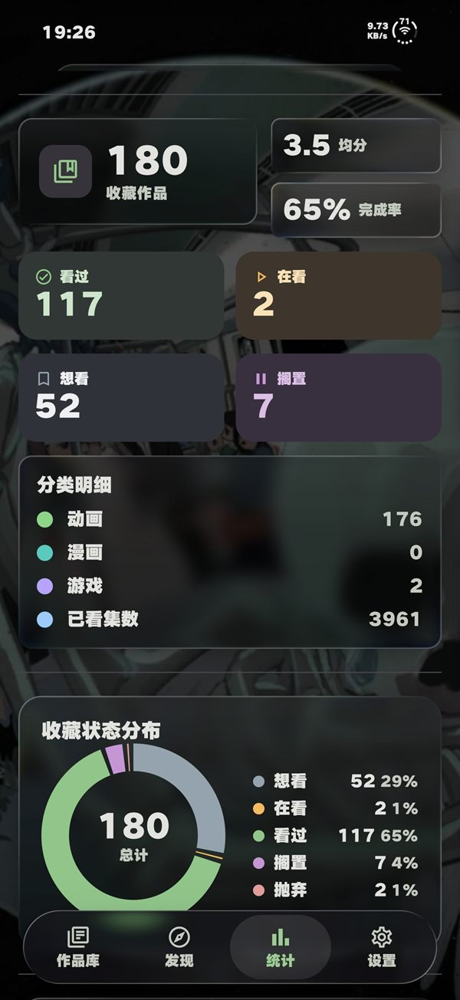 |

| 评分分布与年度总结 | 照片墙 |
| --- | --- |
| 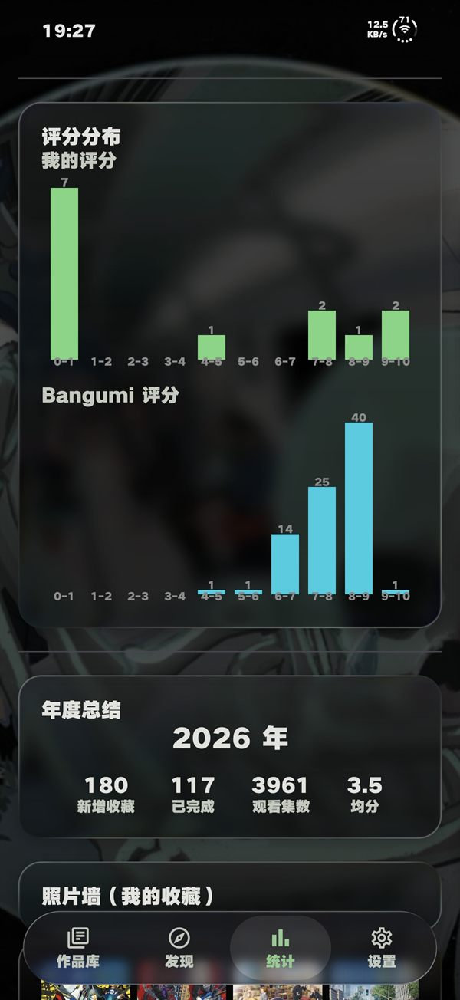 | 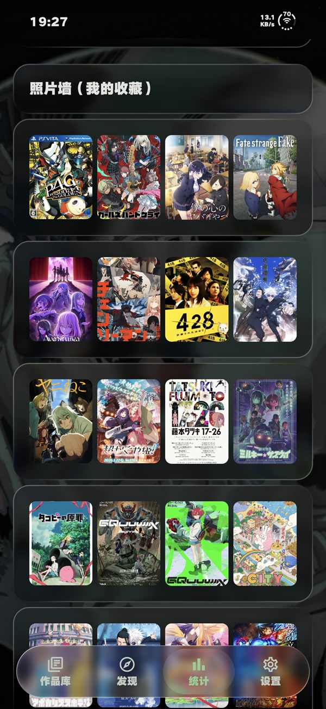 |

### 设置

| 设置（分类导航） |
| --- |
| 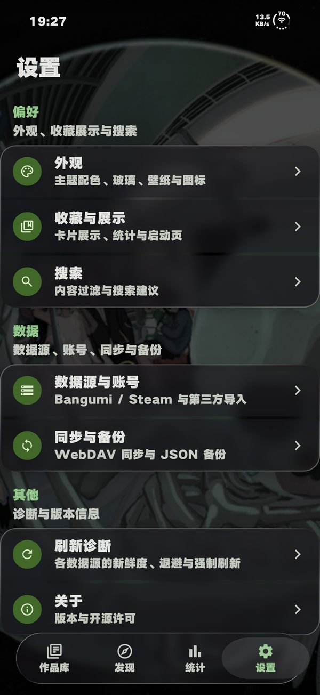 |

---

## 功能总览

底部导航四个顶级页面，用 `HorizontalPager` 承载（左右滑动切换，胶囊玻璃底栏跟手联动）。底栏与页面顶部按钮共用一套显隐状态：向下滚动隐藏、向上滚动恢复（48dp / 16dp 阈值），切页与点空白处复位；隐藏用位移而不是透明度，命中区随控件一起移出。

### 作品库

本地收藏的管理中心。

- **三种视图**：海报网格 / 画廊大卡 / 列表，在展开搜索菜单的工具行右侧切换并记忆
- **排序**：最近修改 / 添加时间 / 评分最高 / 标题 / 观看进度
- **筛选**：观看状态（想看 / 在看 / 看过 / 搁置 / 抛弃）、个人标签、关键词搜索；展开菜单显示各状态的真实收藏数，计数随分区 / 关键词 / 标签范围变化，不被当前选中状态重复过滤
- **卡片展示**：可开关状态标签与集数进度条（设置页控制）
- **批量操作**：多选后批量改状态 / 删除；长按卡片快速改状态
- **收藏的人物**：横向分区，收藏声优 / 作者 / 制作人并在人物详情页查看参与作品
- **自定义分区**：新建 / 改名 / 删除、排序与折叠分区；同一作品可加入多个分区，支持单个或批量加入，左上竖向选择器快速切换，标签宽度随名称伸缩；分区与成员关系随 JSON 备份保存，暂不参与 WebDAV 同步
- **悬浮表头**：左上分区选择器与右上搜索固定在列表上方；搜索沿用原宽度向左 / 向下展开，菜单覆盖信息流，不推移内容或改变滚动位置；排序 / 标签 / 多选 / 视图工具保留在展开菜单中，顶部渐隐随滚动连续变化
- **横滑卡片**：人物收藏、角色、制作人员、关联作品与参与作品卡统一预留文本行，减少长短标题及可选信息引起的轨道高度变化
- **空态引导**：无收藏时提供「开始探索」进入漫搜

### 发现

三种布局：**卡片视图**（全屏列表）、**宫格视图**（菜单宫格 + 本季横向预览）与 **海报视图**（封面网格），在展开搜索菜单的工具行右侧循环切换并持久化。左上竖向选择器切换「当季热门 / 历史排名 / Steam」，与作品库分区选择器位置对齐、状态独立；选择器与搜索展开均覆盖内容，不推移信息流。

- **顶部连续渐隐**：从**屏幕顶部（含状态栏）**开始的独立渐变层，列表滚动时连续变实（非阈值显隐），不拦截点击与滚动手势；内容顶部内距由悬浮控件高度决定，两者互不混淆
- **底部 Dock 重选**：再次点击当前标签时，不在顶部先回顶、已在顶部才刷新（发现页）；作品库 / 统计只回顶

顶栏类型行（搜索菜单内）覆盖 **全部 / 动画 / 书籍 / 游戏 / 音乐 / 三次元**，它同时驱动发现页列表与关键词搜索；发现页保留「作品 / 人物」搜索模式切换。

**① 当季热门** —— 展示「当下有人气」的作品，而不是「本季上线清单」：

- 候选池 = Bangumi 每日放送 `/calendar`（权威在播） ∪ 放宽到 400 天的开播日窗口检索（覆盖播一年的长连载，如特摄）
- 选取：类内热度序 → 评分人数门槛（≥100）→ **类型多样性重排**（窗口内同类 ≤3、连续同类 ≤2、小类保底 3）→ 取前 30
- **零填充**：候选不足就是不足，不用历史排名凑数；列表为空时给「查看历史排名 ›」出口

**② 历史排名** —— 榜单 + 一套完整的筛选器（对齐 Bangumi 网页版「找条目」的筛选能力）：

| 维度 | 选项 |
| --- | --- |
| 地区 | 日本 / 中国 |
| 版本 | TV / 剧场版 / OVA / WEB |
| 年份 | 当前年往前 40 年，含「2000 以前」 |
| 季度 | 1 / 4 / 7 / 10 月 |
| 状态 | 连载 / 完结 / 未播放（按开播日推算，界面有标注） |
| 类型 | 46 个高频内容标签，多选为「且」 |
| 制作 | 动画公司（按标签匹配，含中 / 日 / 英别名展开） |
| 排序 | 排名 / 上映时间 / 评分人数 / 评分 / 随机 / 名称 |
| 收藏 | 隐藏已收藏 |
| 增强 | 评分区间 / 评分人数区间 / 排名区间 / 包含 R18 |

**改动即查询**（无需点「应用」），支持触底分页。类型选「全部」时使用统一发现排序：各类型取候选 → 质量门槛 → 多样性重排 → 前 30。

**③ Steam** —— 商店热销榜前 100（`topsellers`），条目自动尝试匹配 Bangumi 词条，已收藏的显示收藏态；本地已导入的游戏不会混进榜单。

完整搜索页（发现页搜索入口与作品库空态的「漫搜」）支持：Bangumi 语法（`tag:异世界`、`sort:rank`）、拼音子串（`juren` → 进击的巨人）、NSFW（登录后走 v0，未登录走旧版接口兜底）、历史记录、人物搜索，以及**搜索建议**（本地前缀 / 拼音即时命中 + 远程聚合）。搜索空态提供「诊断搜索链路」，可一键查看榜单 / 检索 / 旧版兜底三条通路的 HTTP 状态与返回条数。

### 统计

- **今晚看什么**（v1.2.1）：今天更新的在看作品 + 已看集数 + 放送时刻；无可看内容时不渲染
- **接下来七天**（v1.2.1）：日期 / 首封封面 / 更新数，今天高亮，空列显示「—」
- **漏看提醒**（v1.2.1）：落后 ≥3 集才计数，点击进入筛好的列表
- **收藏健康度**（v1.2.1）：停滞 / 看过未评分 / 无标签 / 想看超一年 四类计数
- **一句话对比**（v1.2.1）：与上月比较的作品数变化，数据不足自动降级
- **完成率口径**（v1.2.1）：胶囊「?」给出三种分母对照，说明为什么剔除「想看」
- **作品日历**（置顶）：个人记录 / 放送信息 / 全部显示三种模式；支持历史月份与跨月延续的放送查询，已有正篇章节日期优先用于延期 / 同日多集归类，日期不全时保留估算；每个选中月份独立显示加载 / 空结果 / 错误与更新时间，刷新不跳回本月，部分来源失败保留可用内容；**停播 / 延期角标**标在格子与日详情上（集数据不完整时不判定）；放送模式下可**导出 `.ics`**（本月 / 本季 / 在追全部，UID 幂等，估算集用每周重复规则）
- **时间线**：iOS Smart Stack 风格卡片堆叠，按作品聚合的操作记录（默认折叠）
- **收藏概览**：作品数 / 均分 / 完成率等胶囊指标
- **收藏状态分布**、**作品类型分布**、**收藏月度趋势**、**评分分布**
- **评分对比**：个人评分 vs Bangumi 评分
- **年度总结**：当前年与历年数据
- **照片墙**：我的收藏封面马赛克
- **标签词云**：按个人标签使用频率映射字号，点击可筛选

### 设置

分类导航（图标 + 一句话说明），点进独立二级页；顶部支持**设置搜索**（覆盖分类与同义词，命中高亮）：

| 分类 | 内容 |
| --- | --- |
| 外观 | 主题模式（跟随系统 / 浅色 / 深色）、动态取色、自定义主题色、OLED 纯黑、玻璃效果强度（含**按设备能力自动降档**）、卡片玻璃、详情页部件显示与排序、**详情页标题 logo 三档**、半调网点、CRT 老电视模式、壁纸（全局与每页）、壁纸柔化与氛围、桌面图标、分享卡包含项、减少动态效果、主题包 |
| 收藏与展示 | 默认排序、收藏卡片状态标签、进度条、年度总结开关、启动页 |
| 搜索 | 允许 R18 内容、显示搜索建议 |
| 数据源与账号 | Bangumi 端点（官方 / 国内反代）、Bangumi OAuth 登录、NSFW 检索状态、Steam API Key 与账号游戏库、权威评分源密钥（TMDb / OMDb / IGDB / RAWG / Discogs / OpenCritic）、豆瓣剧照与灰通道、Kazumi / 哔哩哔哩导入入口 |
| 同步与备份 | WebDAV 同步（含自动同步与冲突优先级）、JSON 全量备份导出 / 恢复、Bangumi 收藏同步 |
| 刷新诊断 | 各数据源新鲜度、失败次数、退避剩余与最近错误；强制刷新 / 清除刷新记录；**数据体检**（8 项只读检查）、**图片占用清理**、**本地快照**（立即创建 / 最近 5 份）、**数据源自检**（能力矩阵 + 串行探测）、**检查更新**（只提示并打开发布页） |
| 关于 | 版本、开源许可、反馈入口 |

### 二级页面

| 页面 | 路由 | 说明 |
| --- | --- | --- |
| 作品详情 | `subject_detail/{id}` | 见下 |
| 单集详情 | `episode_detail/{subjectId}/{epId}` | 剧照、我的评分（0–10）、我的评价（停止输入自动保存）、该集权威评分、本集简介、上一集 / 下一集、看到这里、二刷标记、Bangumi 章节页外链 |
| 人物详情 | `person_detail/{id}` | 基本信息（性别 / 生日 / 血型 / infobox）、参与职位统计、收藏数与评论数、配音角色与参与作品 |
| 角色详情 | `character_detail/{id}` | 基本信息、出演作品横滑卡（与人物页共用卡片）、收藏数与评论数、Bangumi 角色页外链 |
| 制作人员列表 | `staff_list/{subjectId}` | 该作品全部 staff |
| 漫搜 | `subject_search` | 沉浸式搜索页（含趋势区） |
| 哔哩哔哩导入 | `bilibili_sync` | 登录 B 站 → 拉取追番与评分 → 匹配 → 勾选导入 |
| Steam 游戏库 | `steam_sync` | 登录 Steam → 拉取游戏库（含家庭共享）→ 匹配 → 勾选导入 |

**作品详情页**由评分卡与多个区块组成：

- **评分与对照**：我的评分 · 社区评分（Bangumi / Bilibili + 评分争议度 + 本地库内同类型百分位） · 权威评分（多源对照） · 评分分布 · 榜单成绩（手动录入）；评分卡与下方纵向区块展示，评分刻度带轻触感，10 分松手有满分配色确认（减少动态效果时保留静态金色）
- **剧集**：集号 / 标题 / 播出日 / 时长 / 讨论数 / 每集评分角标 / 剧照缩略图 / 展开看单集简介 / 「看到这里」写回进度；附评分走势曲线
- **进度写满反馈**：把最后一集 / 卷标为看过时，剧集区块从左到右波浪点亮一次（只在写入时触发，初次加载与重复保存不触发）
- **分集评价汇总**：预览并将各集短评汇入作品感想，支持自定义前后缀；可单独汇总短评、计算作品均分或同时生成，均分可按半分 / 整数舍入；重复生成只更新自动块，保留块外手写内容
- **区块可定制**：设置 → 外观 → 详情页部件，按偏好显示 / 隐藏与排序，支持恢复默认顺序（封面 / 标题 / 收藏按钮不可隐藏）
- **完整标题**：作品主标题完整换行展示；社区、Steam 与 VNDB 标签使用统一材质与可读性配色
- **标题 logo**：可从 TMDb 取作品字标替代文字标题，中文优先、其次日文，宽度约为海报宽的 2/3 并居中；对比度不足或无中日字标时回退文字（设置 → 外观 → 详情页标题）
- **区块折叠**：Steam / 权威评分 / AniList / VNDB / TMDb 绑定区块可收起，按作品记忆
- **分享**：分享面板可生成评分对照卡；作品库长按可生成当前分区的 3×4 多页海报
- **剧照**：TMDb 背景图 + 每集剧照 + B 站分集封面 + Anitabi 取景截图 + Steam 截图（豆瓣为可选灰通道），统一进全屏查看器
- **角色 / 制作人员 / 关联作品**：横滑卡片，可跳转
- **猜你喜欢**：按本地标签共现 + 同类型评分的纯本地推荐（前 10）
- **圣地巡礼**：Anitabi 取景地标（缩略图 + `EP{集} mm:ss · #N`）+ 巡礼地图外链（仅动画、非 NSFW）
- **外部信息源区块**：Steam（价格 / 当前在线 / 开发商 / 发行商 / Metacritic / 标签 / 截图 / 成就进度 / 活跃排名）、VNDB（平均时长 / 贝叶斯评分 / 原语与语言 / 平台 / 权重标签 / 截图 / relations）、AniList（原名 / 评分 / 状态 / 格式 / 标签）、TMDb（网络 / 制作公司 / 状态 / 单集时长 / 多语言海报 / 逐集评分入口）、权威评分（多源对照 + 手动录入成绩）
- **简介富文本**：作品简介 / VNDB 简介 / 人物小传 / 角色介绍按 HTML · BBCode 富文本渲染（换行 / 加粗 / 斜体 / 列表），链接可点，Bangumi 作品链接原地跳作品页；卡片副标题与分享文案复用同一解析器的纯文本出口
- **操作**：分享卡、更换封面（TMDb 多语言海报 / 当前源 / 相册）
- **外链门户**：一键跳转到 23 个外部平台 —— Bilibili / Bangumi App / Steam / VNDB / AniList / 网易云音乐 / QQ 音乐 / Mihon / IMDb / TMDb / MyAnimeList / AniDB / 豆瓣 / Fami通 / Metacritic / OpenCritic / Billboard / Oricon / MusicBrainz / Discogs / RateYourMusic / Goodreads / 批评空间。统一走「精确 scheme → 搜索 scheme → 网页」三级降级；对当前作品无可用动作的目标会自动隐藏

### 跨页面能力

- **封面共享元素过渡**：列表 / 画廊 / 关联作品封面 → 详情页，采用 200ms 共享浅弧路径与轻量落位弹性；从详情返回复用反向路径，对应海报播放一次短暂余光；系统返回手势预览中不播放落位弹性，减少动态效果时关闭弹性
- **预测性返回**：支持系统返回手势预览与取消，搜索 / 日历局部状态与页面返回协调
- **连续顶部渐隐**：作品库、发现与详情的顶部渐变独立于列表布局，随滚动连续变化，不消费点击或滚动手势
- **Liquid Glass**：悬浮胶囊底栏、搜索入口与展开面板、详情标签和海报状态 / 评分 / 进度小件采用统一玻璃材质；浅色模式使用更清晰的白底与对比度配色，底栏真实折射壁纸（按设置分级降级：全效果 / 降低 / 关闭）
- **入场动画**：滚动进入视口才播放并错峰；系统「关闭动画」或设置「减少动态效果」时跳过
- **离线可用**：搜索结果与详情自动落库；远程失败时回退本地缓存（并在界面标注为离线结果）
- **全屏图片查看器**：翻页 + 捏合缩放 + 双指平移 + 双击缩放 + 保存到相册 + 浏览器打开原图
- **分享卡**：把作品或收藏渲染成海报卡（可含评分 / 进度 / 个人标签）后调用系统分享
- **放送提醒**：对「在看」条目按放送时间推送通知（WorkManager 周期任务，开机自动恢复）

---

## 数据源与整合

Niriko 以 Bangumi 为主体，其他源按能力补充；Bangumi 无词条时，外部源可以成为与 Bangumi 作品同等的一等条目。

### Bangumi（主数据源）

- `/calendar` 每日放送、`/v0/subjects` 浏览与榜单、`/v0/search/subjects` 条件检索、详情 / 剧集 / 角色 / 人物 / 关联；历史放送日期窗口使用 POST 检索的 `sort=rank` + `air_date` 筛选并完整分页
- **OAuth 登录**：应用内完成授权（用户在 Bangumi 自建应用，不内置公共应用 id）；登录后 NSFW 检索走 v0，未登录时走旧版接口兜底
- **端点可切换**：官方 `api.bgm.tv` 或国内反代，切换即时生效（含图片域重写）
- 内置每季放送静态数据 `assets/data/onair/*.json`，为本地作品补齐精确放送时刻

### AniList（兜底 + 补充）

无需密钥、国内可直连。用于动画 / 漫画的补充信息与**独立条目兜底**（`sourceKey="anilist:media-{id}"`）；绑定关系存 `anilist_bindings`，不限制作品类型。标题匹配只产出候选，由用户确认后才写库。

### Steam（游戏商业数据 + 游戏库导入）

作为 GAME 的补充源：价格、当前在线人数、开发商 / 发行商、Metacritic、标签、截图、成就进度、活跃玩家排名（Top 100）。

- 公开接口（`storesearch` / `appdetails` / `GetNumberOfCurrentPlayers` / `GetMostPlayedGames`）无需密钥；`GetOwnedGames` 与成就接口需 API Key
- **游戏库导入**：OpenID 2.0 登录或手动填 SteamID64 → 拉取本人库 + 家庭共享库 → 匹配 Bangumi → 勾选导入；游玩时长推断状态（玩过 → 在看，未玩 → 想看）
- Steam 独占条目：Bangumi 无词条的游戏以 `sourceKey="steam:{appid}"` 落库，打开详情页会自动重新尝试匹配 Bangumi（命中即升级为正式词条）

### VNDB（视觉小说）

作为 GAME（视觉小说）的补充源与兜底源：平均游玩时长、贝叶斯评分与票数、popularity、原语与支持语言、平台、按权重排序的标签、截图、relations（前作 / 续作 / 同世界观 / 外传 / 同系列 / 另一版本 / 共用角色 / 同人 / 原作）。走 VNDB REST API v2，无需密钥；支持实际响应中的小数评分与多语言标题，统一评分同时保留 100 分制原生值与 10 分制换算。

### 权威评分源

统一 `RatingSource` 注册表（与游戏数据源同构：注册序即优先级、按作品类型派发、未配置密钥的源自动隐藏、单源失败不影响其它源）：

| 作品类型 | 接入源 |
| --- | --- |
| 动画 / 三次元 | TMDb（主）、OMDb / IMDb（可选，逐集需显式触发） |
| 游戏 | Steam 好评率（无需密钥）、Metacritic（Steam 字段）、IGDB、RAWG、OpenCritic |
| 音乐 | MusicBrainz（含社区评分，无需密钥）、Discogs |
| 书籍 | Google Books、Open Library |
| 视觉小说 | VNDB（并入统一评分卡） |

支持「原生分 + 10 分制换算」并存展示（避免跨源误读），并提供「全部票数 / ≥10 票 / ≥50 票」的票数门槛筛选。

### Anitabi（圣地巡礼）

动画条目详情页的「取景地标」：`api.anitabi.cn/bangumi/{id}/lite`，D7 快照缓存，仅动画且非 NSFW 触发，附巡礼地图外链。

### 豆瓣（灰通道，默认关闭）

用于补充剧照。三条链路（rexxar JSON → frodo JSON → HTML 剧照页）依次尝试，请求头（UA / Cookie / Referer）可在设置中修改，失败静默降级不影响其它剧照来源。设置页提供**连通性自检**：逐端点显示 HTTP 状态码、耗时、最终 URL、Content-Type 与响应前 400 字节。

> 豆瓣未授权第三方抓取，该通道默认关闭、仅供个人查看；若需分发建议移除。

### 统一匹配服务

外部源绑定（VNDB / AniList / TMDb / 豆瓣）共用一套四层匹配：

1. **infobox 明确 ID**（置信度 1.0，命中后不再发查询）
2. **多查询串**：中文名 → 原名 → infobox 别名 → ASCII 变体；高置信命中即停止
3. **多字段打分**：标题相似度 × 年份（冲突 ≥3 年扣分）+ 集数 + 平台，输出匹配理由
4. **手动兜底**：关键词搜索（不过滤低分候选）+ 粘贴 ID / 链接

写库策略偏保守：VNDB / AniList / TMDb / 豆瓣只产出候选，由用户确认；Steam 由 appid 精确标识，允许自动绑定。

候选显示实际匹配度与理由；AniList 手动绑定支持 `media-` 前缀 ID，并在失败时给出反馈。Steam 标题匹配兼容中文标题的空格差异，VNDB 使用多查询串与别名集合匹配，仍保留人工确认以避免续作或同名作品错绑。

---

## 收藏模型

- **状态**：想看 / 在看 / 看过 / 搁置 / 抛弃；动词按类型显示——动画·三次元「看」、书籍·漫画「读」、游戏「玩」、音乐「听」
- **进度**：动画 / 三次元按集；书籍 / 漫画分别记录**卷 / 话进度**，进度条按对应单位选用分母；游戏记录游玩时长（存储为分钟，界面显示小时）；音乐记录**已听曲目**（曲目列表仅在收藏编辑弹层显示，超过 12 首时先展示预览并可展开全部；勾选后保存才写入，详情正文不重复展示）
- **评分与评价**：0–10 分与短评；支持标记**二刷**
- **个人标签**：用于作品库筛选与统计页标签词云
- **私密收藏**：本地可见，导出与 WebDAV 同步会排除
- **单集数据**：每集的我的评分 / 评价 / 二刷，独立于作品级评分

---

## 导入与同步

| 功能 | 说明 |
| --- | --- |
| **JSON 全量备份** | 格式 v4，支持读取 v1–v4；导出 / 恢复收藏、作品元数据、手工条目、搜索历史、人物收藏、外部绑定、封面覆盖、单集评价、手动成绩，以及自定义分区与成员关系；合并恢复保留本地同名分区的成员，重复恢复不重复添加 |
| **WebDAV 同步** | 先下载并按 LWW（最后写入胜出）合并到本地，再把合并结果发布回远端；手动与自动同步串行化互斥；失败进入退避梯并在设置页显示「上次同步 / 下次可重试时间」 |
| **自动同步** | 回到前台触发，节流 15 分钟；可在设置页开关 |
| **Bangumi 收藏同步** | 应用内 OAuth 登录后可把本地收藏同步到 Bangumi 账号（可设冲突优先级：本地优先 / 远端优先），支持自动同步 |
| **Kazumi 导入** | 读取 Kazumi 导出的 `collectibles.hive`，预览后勾选导入（仅动画，默认跳过已存在） |
| **哔哩哔哩导入** | WebView 内登录 B 站，注入脚本拉取追番列表、用户评分与短评，按 season_id / 标题匹配后勾选导入（默认不覆盖已有评分） |
| **Steam 游戏库导入** | 见「数据源与整合 · Steam」 |

---

## 主题与个性化

### 自定义主题色

任意种子色 → 完整 M3 配色（HCT TONAL_SPOT 配方）；提供 HSV 取色面板（色相条 + 饱和度 / 明度面板）、HEX 输入与精选快捷色板，实时预览。优先级：Material You 动态取色 > 自定义种子色 > 默认品牌绿。

### 壁纸

四个顶级页背景，支持全局一张 + 每页覆盖；静态图（Coil）与动态视频（Media3 ExoPlayer 循环静音，退后台或进二级页暂停解码）。可调高斯柔化强度与氛围（浓郁 / 均衡 / 素净）。壁纸层与悬浮底栏共用 backdrop 捕获层，胶囊底栏因此能真实折射壁纸。

### 主题包（`.nirikotheme`）

ZIP 包：`theme.json`（必需）+ 可选壁纸文件 + 每页覆盖，包体上限 50MB。可通过应用内选择器或系统「打开方式」导入（已注册文件关联），也可把当前配色与壁纸导出分享。导入时校验 zip 炸弹 / 路径穿越 / JSON 合法性。

### 桌面图标

Android 平台限制下启动器图标只能来自 APK 预置资源，因此采用标准方案：主题色或上传图片生成 Bitmap → 固定快捷方式（ShortcutManager）→ 隐藏本体图标（禁用 activity-alias）。

实现要点：

- **确认后才隐藏**：只有确认桌面确实已存在该快捷方式，才会隐藏本体图标；无法确认时保留原图标并给出原因
- **旧版广播兜底**：官方钉入接口不可用时，补发旧版 `INSTALL_SHORTCUT` 广播（MIUI / HyperOS 系需先在系统里允许「桌面快捷方式」权限）
- **自动恢复**：快捷方式缺失时，回到前台自动恢复本体图标，避免应用从桌面「消失」
- **手动隐藏需确认**：桌面没有任何 Niriko 快捷方式时，隐藏前会明确提示只能从系统设置进入应用

### 动画体系

弹簧规范（入场 damping 0.85 / 按压 0.75），公共组件 `RevealOnScroll` 让列表项进入视口才播放并错峰；「减少动态效果」开关或系统动画关闭时自动跳过。评分滑块跨刻度提供轻触感，满分松手给出确认，完成进度与返回海报采用一次性反馈，避免页面重组或重复保存时反复播放。

### 阅读与复古效果

- **半调网点**：书籍 / 漫画详情页默认启用低强度静态网点，其他类型不启用；点阵绘制在内容下方，外观设置中可独立关闭
- **CRT 老电视模式**：默认关闭；开启后，仅对明确首播年份早于 2000 年的动画详情播放约 4 秒扫描线、淡色边缘、有限噪点与暗角，随后恢复静态；年份未知或开启「减少动态效果」时不播放。曲面观感以轻微缩放与暗角近似，不包含真正的桶形几何畸变

---

## 技术栈与架构

| 层 | 选型 |
| --- | --- |
| UI | Jetpack Compose + Material 3（Compose BOM）、Navigation Compose、Material Icons Extended |
| 架构 | 单 Activity + `HorizontalPager` 四个顶级页 + NavHost 承载二级页；ViewModel 手写 Factory（**无 DI 框架**）；Repository 层；统计 / 趋势 / 发现等纯函数计算器（可单测） |
| 本地存储 | Room（KSP，23 张表）+ DataStore Preferences（设置）+ 应用私有文件（主题包 / 上传的图标） |
| 网络 | Retrofit + OkHttp + Kotlin Serialization；数据源以插件链注册（Bangumi 主源 + AniList 兜底 + Steam / VNDB / 游戏源旁路） |
| 图片 | Coil Compose（显示尺寸感知解码）；telephoto zoomable 0.19.0（全屏查看器的子采样缩放 + 缩放态平移边界） |
| 主题 | material-color-utilities（HCT 配色）、Media3（动态壁纸）、core-splashscreen |
| 后台 | WorkManager（放送提醒） |
| 玻璃 | miuix-blur 0.9.0 + kyant backdrop（配合自实现的折射 / 模糊，按设置等级降级） |
| 搜索 | pinyin4j（拼音键与子串命中） |
| 测试 | JUnit4（纯 JVM 单测） |

依赖集中声明在 `gradle/libs.versions.toml`，应用模块在 `app/build.gradle.kts`。

---

## 数据模型与迁移

Room 数据库 `NirikoDatabase`：**version 32**，迁移链 `v2 → v32`，使用显式迁移，不以破坏性重建代替升级。v29 移除了旧评分快照表；v30 新增详情缓存，v31 调整集合缓存键，v32 新增分区与成员表。

23 张表分五类：

- **核心**：`work_items`、`subjects`、`collections`、`search_history`、`person_collections`
- **外部数据源扩展**（不污染核心作品模型）：`steam_games`、`steam_bindings`、`steam_library_items`、`vndb_bindings`、`anilist_bindings`、`bilibili_sync_items`、`subject_external_ids`、`subject_external_ratings`、`anitabi_points`
- **剧集与用户数据**：`episodes`、`episode_ratings`、`episode_my_ratings`、`manual_awards`
- **详情持久缓存**：`subject_detail_cache`、`subject_relation_cache`、`episode_external_cache`
- **自定义分区**：`library_folder`、`library_folder_subject`（一作多区的成员关系）

**条目身份**：`subjects.sourceKey` 是跨数据源稳定唯一键（`steam:570` / `anilist:media-123` / `vndb:v123` …），Bangumi 条目为 `null`；旧版负数占位条目会在启动时幂等迁移。

`app/schemas/` 由 Room 导出，**需要随仓库提交**（迁移校验依赖它）。

---

## 刷新与缓存

所有「要不要刷新 / 刷新几次 / 失败了怎么办」由一处裁决（`data/refresh/RefreshCoordinator`）：

- **新鲜度**：每个资源有软 / 硬 TTL（趋势、放送日历、季节、剧集、Steam、Anitabi 各不相同；作品详情软 TTL = 0，保持「进页面即出缓存 + 后台刷新」的体感）；状态持久化，冷启动不会全量重跑
- **去重**：同 key 并发请求合并为一次（下拉、重试、切类型、进前台可能同时触发）
- **串行**：WebDAV 的「读远端 → 合并 → 写远端」串行化，手动与自动同步互斥
- **退避**：失败后 30s / 60s / 120s / 300s 不再自动重试；用户主动下拉或重试可绕过 TTL 与退避
- **写放大治理**：所有 `subjects` 落库走写入网关，单事务批量 + 内容 diff 写；重复刷新同一份数据是零写入
- **生命周期**：进前台触发一轮受控刷新，退后台取消轻量前台任务
- **可观测**：设置 →「刷新诊断」列出各资源新鲜度、累计失败、退避剩余与最近错误，并提供强制刷新与清除记录；发现页与统计页显示「上次更新 X 分钟前」，点按即强制刷新；发现页保留下拉与点按刷新，不再额外显示「点此强制刷新」文字
- **详情恢复**：会话快照与 Room 外部缓存保留已接入的详情、关联和分集外部结果；二次进入与进程重启优先展示本地结果，尚未接入的来源仍可能重新请求
- **剧集补全**：TMDb 只补空缺的分集标题，刷新保留已回填剧照；热门条目合并日历与检索结果时补全空缺简介
- **封面分析缓存**：亮度 / 主色 / 模糊复用 480px 软件 Bitmap，按实际分配字节限制为 8MiB，同 URL 并发加载合并；模糊结果采用逐项 LRU 淘汰，显示封面仍保留独立的尺寸与硬件解码策略

---

## 构建与运行

### 环境要求

- Android Studio Hedgehog 或更新版本
- JDK 21（玻璃库的 JVM 字节码要求 Java 21，组合生命周期回归需该运行时；推荐使用 Android Studio 自带 JBR；如需显式指定，请在环境变量 `JAVA_HOME` 或**本机** `~/.gradle/gradle.properties` 中设置 `org.gradle.java.home`，不要写进仓库——那会把构建绑死在某台机器上）
- Android SDK 34+（compileSdk 37）

### 常用命令

```bash
# 调试包（产物：app/build/outputs/apk/debug/app-debug.apk）
.\gradlew.bat assembleDebug

# 单元测试（纯 JVM，无需设备 / 模拟器）
.\gradlew.bat testDebugUnitTest

# 发布包
.\gradlew.bat assembleRelease

# 代码格式检查（只校验相对基线的改动，见「开发约定」）
.\gradlew.bat :app:spotlessCheck

# 自动修复本次改动文件的格式
.\gradlew.bat :app:spotlessApply
```

用 Android Studio 直接打开本目录、等待 Gradle Sync 完成后点运行也可以。Debug 包与正式 Release 包的签名可能不同，不能直接互相覆盖安装；用于保留现有调试安装数据的同证书非 Debug 诊断副本仅供测试，不是正式发布包。

---

## 目录结构

```
app/src/main/java/com/otakup/niriko/
├── data/
│   ├── local/          # Room 数据库、DAO、实体（迁移链 v2→v32）
│   ├── remote/         # Bangumi / AniList / Steam / VNDB / TMDb / 豆瓣 / Anitabi / Bilibili 客户端与 DTO
│   ├── repository/     # 收藏 / 作品 / Steam / VNDB / AniList / Anitabi 等仓库
│   ├── discover/       # 发现页统一排序（DiscoveryFeed）与「找条目」筛选模型（BrowseFilter）
│   ├── seasonal/       # 当季热门：候选池、在播判定、人气选取
│   ├── calculator/     # 统计、趋势、评分洞察、每集对齐等纯函数
│   ├── match/          # 统一外部匹配服务（四层）
│   ├── refresh/        # 刷新编排（新鲜度 / 去重 / 串行 / 退避）
│   ├── probe/          # 灰通道连通性探针
│   ├── onair/          # 内置放送静态数据
│   ├── themepack/      # .nirikotheme 主题包
│   ├── notification/   # 放送提醒调度与 Worker
│   └── filter/ · search/ · settings/ · sync/ · backup/
├── plugin/             # 数据源插件链与导入器（Kazumi / Bilibili）
├── navigation/         # 底部导航、Pager、NavHost
├── ui/                 # 各页面与通用组件（玻璃卡片、封面、搜索栏、图片查看器、分享卡…）
├── viewmodel/          # ViewModel 与手写 Factory
└── util/               # 标题解析、封面 URL、放送状态、拼音、异步工具等

app/src/main/assets/data/        # 放送静态数据（onair/*.json）与 B 站站点映射
app/schemas/                     # Room 导出的 schema
docs/                            # 设计与调研文档
```

---

## 开发约定

- **无 DI 框架**：依赖在 `NirikoApplication` 集中装配，ViewModel 通过手写 Factory 接收
- **纯函数优先**：统计 / 排序 / 匹配 / 在播判定等逻辑抽成不依赖 Android 的纯函数，便于单测
- **KDoc 用「」而非反引号**（本工程构建工具链对反引号处理不稳定）
- **代码格式门禁**：Spotless + ktlint，规则以仓库根 `.editorconfig` 为准（Android Studio 风格、不设行长硬上限、关闭尾逗号规则）。采用 ratchet 策略：本地只检查相对 `HEAD` 的改动，CI 只检查相对 `origin/main` 的 diff——存量文件约 244 个仍有历史格式偏差，按「改到哪个文件就顺手用 `spotlessApply` 修哪个」逐步收敛，不做一次性重排
- **Room 迁移的 DDL 必须与 `app/schemas` 导出的 `createSql` 逐字一致**——schema 校验只在真机首次开库时执行，编译期不会报错
- **新增逻辑请补 JVM 单测**：用例覆盖统计、趋势、发现排序、筛选映射、匹配打分、刷新策略、解析器、简介富文本（HTML / BBCode）解析与链接识别、图表分桶与累计、雷达图几何、日历周/月映射与 31 天日期条几何、窗口尺寸类别与折痕分栏、玻璃降级判定、壁纸库编解码与轮换顺延、非模态面板关闭阈值、顶部页面指示器几何、分区 DAO 与备份恢复、详情缓存、分集评价合并、曲目进度、详情部件布局、评分反馈、完成波浪、网点 / CRT、连续顶部渐隐与横滑卡行数规则、顶部控件布局与状态计数、历史月份状态与检索契约、VNDB 实际响应解析、共享浅弧路径与弹性、封面分析缓存等
- 引入新第三方依赖前先讨论，优先使用平台 API 与已有库实现

---

## 设计文档

`docs/` 保留了各阶段的设计、方案与调研记录，可作为实现细节的补充阅读：

| 文档 | 主题 |
| --- | --- |
| `docs/bangumi-reference-plan.md` | 以 Bangumi 客户端为参照的功能规划 |
| `docs/anishelf-reference-plan.md` | 以 AniShelf 为参照的功能规划 |
| `docs/portal-feature-plan.md` | 外链门户 / 传送门设计 |
| `docs/refresh-architecture-plan.md` | 刷新编排架构（新鲜度 / 去重 / 退避 / 写放大） |
| `docs/rating-data-sources-research.md` | 各评分源的 API、限流与覆盖度实测 |
| `docs/authoritative-ratings-detail-parity-plan.md` | 权威评分与详情页对齐方案 |
| `docs/aggressive-data-and-episode-page-plan.md` | 剧集数据与单集页方案 |
| `docs/ui-redesign-plan.md` · `docs/liquid-glass-card-upgrade-plan.md` · `docs/dock-kyant-migration-plan.md` | UI / 玻璃质感改造 |
| `docs/performance-audit.md` | 性能审计 |
| `docs/remaining-phases.md` | 后续阶段清单 |
| `docs/top-controls-and-motion-plan.md` | 顶部控件、历史月份与共享转场方案 |
| `docs/repair-verification-report.md` | 修复记录与验证边界 |
| `docs/phone-shared-motion-profile.md` | 实机共享海报性能观测与封面分析缓存记录 |
| `docs/detailed-execution-plan.md` | 功能与修复执行计划、分批实现记录、验证证据及待验收边界 |
| `docs/fix-and-redesign-plan-round{3,4,5,6}.md` | 各轮问题定位与解决方案（含验收与踩坑记录） |
| `docs/v1.2.2/` | v1.2.2 的视觉 / 动效 / 反馈审计与实施记录（00 现状地图 → 06 路线图，附 `impl-summary.md` 与 `review-visual.md`） |
| `docs/ios-port/` | iOS / KMP 移植可行性调研（spike、依赖映射、模块划分等） |

---

## 数据来源与声明

- 作品元数据来自 **Bangumi 番组计划**（`api.bgm.tv`），版权归 Bangumi 及各权利方所有；本应用仅作个人收藏管理用途
- **AniList** 用于补充与兜底；**VNDB** 用于视觉小说信息；**Anitabi** 提供取景地标数据
- **Steam** 相关数据来自 Steam 商店与 Web API，版权归 Valve 及各发行商所有
- 本应用使用 **TMDb API**，但未获得 TMDb 的认可或认证（This product uses the TMDb API but is not endorsed or certified by TMDb）
- **OMDb** 内容按 CC BY-NC 4.0 提供，**不可用于商业用途**
- **豆瓣** 通道是默认关闭的灰色通道；豆瓣未授权第三方抓取，仅供个人查看使用。代码内置了一个社区公开的 frodo apikey（非豆瓣官方发布、可能随时失效）；若要分发衍生版本，请自行评估并替换或移除该通道
- 本仓库以 **MIT License** 开源（见 `LICENSE`）；随应用分发的第三方依赖、内嵌源码与数据来源的许可声明见 `THIRD-PARTY-NOTICES.md`

---

## 已知限制与后续计划

### 功能限制

- 历史排名筛选器中的**评分区间 / 评分人数区间**目前是「候选池内本地过滤」，不是服务端全量过滤（检索通路暂未暴露这两个参数）；其余维度均为服务端过滤
- 历史排名的筛选面板是内联可折叠面板（默认收起），不是弹出式 sheet
- VNDB / AniList / TMDb / 豆瓣的绑定不会自动写库（只产候选，避免错绑）；仅 Steam 由 appid 精确匹配后自动绑定
- 角色的声优（CV）列表：Bangumi 没有「按角色查声优」的端点，角色详情页不展示 CV（人物页的「配音角色」不受影响）
- TMDb 多季作品按年份 + 集数自动挑季，暂未提供手动指定季号
- 豆瓣「防剧透翻页」参数已就绪但未启用
- 历史放送依赖日期窗口检索与成功取得的章节数据；候选窗口和章节预取有上限，日期不足时仍可能使用估算，不能保证每个月份的全部条目均完整
- 完全冷封面尚未取得原始比例时，共享转场仍需等待图片数据；现有缓存与转场优化不保证所有入口无闪动或固定帧率

### 工程待办

- WebDAV 同步尚未纳入 `subject_external_ids`、`episode_my_ratings`、`manual_awards`、封面覆盖及自定义分区等数据（JSON 备份已包含）；分区是本地组织方式，不会随 WebDAV 覆盖到另一台设备
- 按源限流闸门（IGDB 4 req/s、MusicBrainz 1 req/s、VNDB 200 次 / 5 分钟）已实现，落在 `util/SourceRateLimiter.kt` 与 `util/SourceRateLimits.kt`，已接入评分请求与 VNDB 客户端；同时继续靠「高置信提前停止查询」与批量查询进一步降低请求量
- Room 迁移测试已有两层：静态迁移链校验（`NirikoMigrationChainTest`，5 例）+ 基于 Robolectric 真实 SQLite 的迁移测试（`RoomMigrationTest`，3 例：逐边界建库比对目标 schema、每个已导出起点升到当前版本、以及 v25 schema 缺口不影响 24→25→26 链）
- 详情页会话快照已补齐 VNDB 匹配结果等此前遗漏字段，并有快照往返测试；Room 外部缓存仍为分批接入，尚未覆盖所有来源，二次进入可能仍重跑未接入来源的请求
- 共享海报已有实机性能观测，但冷 / 暖图、预测返回取消与落位弹性等仍需持续复测；顶部选择器跨窗口玻璃与窄屏交互、历史月份实网结果及复古效果也需设备验收，JVM 单测和单次采样不代替完整视觉与性能测试
- 平板 / 折叠屏自适应布局已实现：宽屏（≥840dp）改用竖向玻璃 dock（`ui/bottombar/LiquidVerticalDock.kt`），详情页并排两栏且折痕处内容不跨越（`ui/adaptive/AdaptiveDetailScaffold.kt`），设置页为「分类导航列 + 二级页正文列」；帐篷模式（水平折痕上下分栏）首轮未做
- `release` 构建已配置签名：凭据只从本地 `keystore.properties`（已在 `.gitignore` 中，切勿提交）读取，该文件不存在时 `assembleRelease` 才会退化为未签名 APK
- `compileSdk = 37` 需要本机安装 Android SDK Platform 37.0，Android Studio 版本过旧时可能同步失败；另外 AGP 8.13.2 官方只测试到 compileSdk 36.1，构建会打印一条「未测试的 compile SDK」警告（属预期，不影响产物）
- 仓库已附带 CI（`.github/workflows/android-ci.yml`：JDK 21 → 单元测试 → 构建 → 上传测试报告），但尚未在真实 GitHub runner 上验证过；本地仍需 `.\gradlew.bat testDebugUnitTest`。CI 中**没有**截图视觉回归步骤：B6 探针已证伪该方案——kyant backdrop 与本项目自己的 AGSL 着色器在 Robolectric 的 native SkSL 下编译失败（`error: 4: 'color' is not a valid layout qualifier` 与 `error: 50/51: cannot swizzle value of type 'shader'`），失败点在 `DrawBackdropNode.onAttach`，任何走真玻璃的卡片都无法离屏光栅化
- `app/schemas` 中确实缺少 v25 的 schema 文件，但**迁移测试不需要它**：Room 只会读起点与终点版本的 schema，`RoomMigrationTest` 直接用 `24.json` 建库再跑生产的 `MIGRATION_24_25` + `MIGRATION_25_26` 对 `26.json` 校验；该文件无法重新生成（仓库历史已被压缩，`git log -S 'version = 25'` 零命中），手工伪造 identityHash 必然错误，因此保持缺失